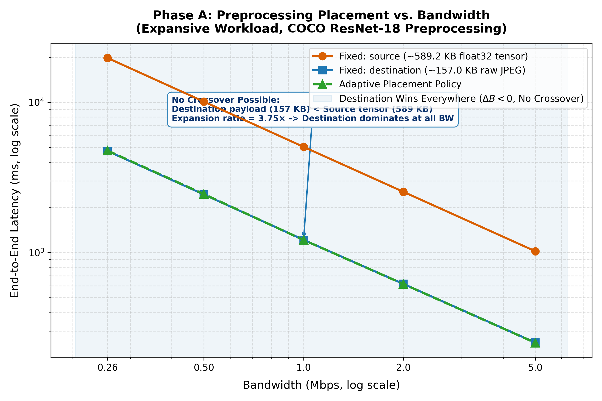
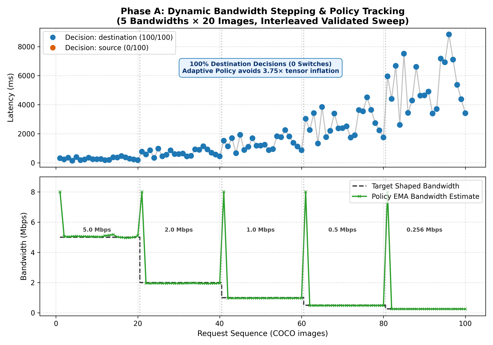
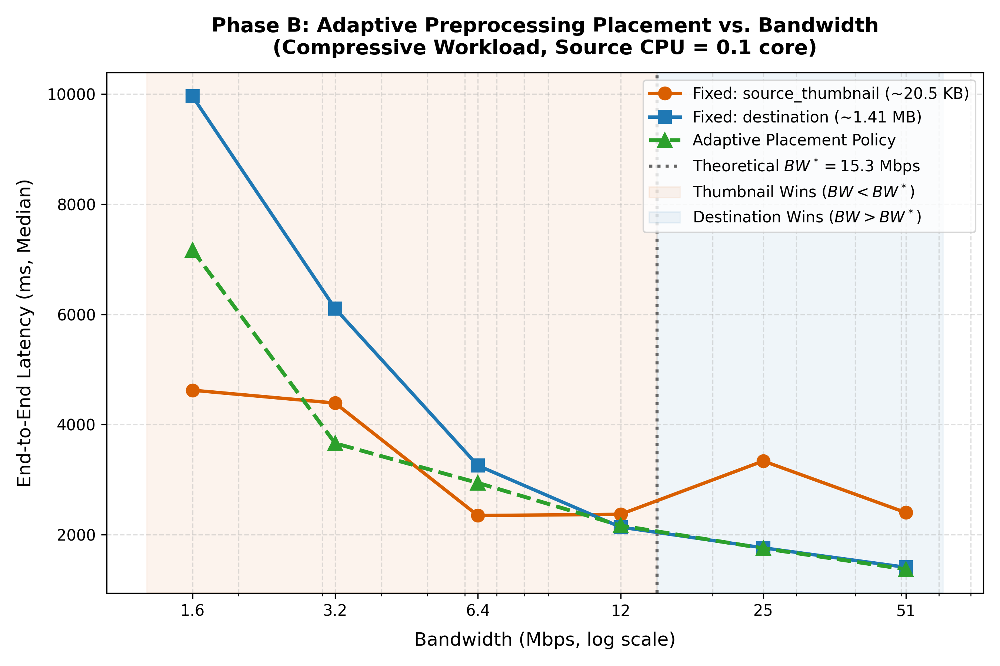
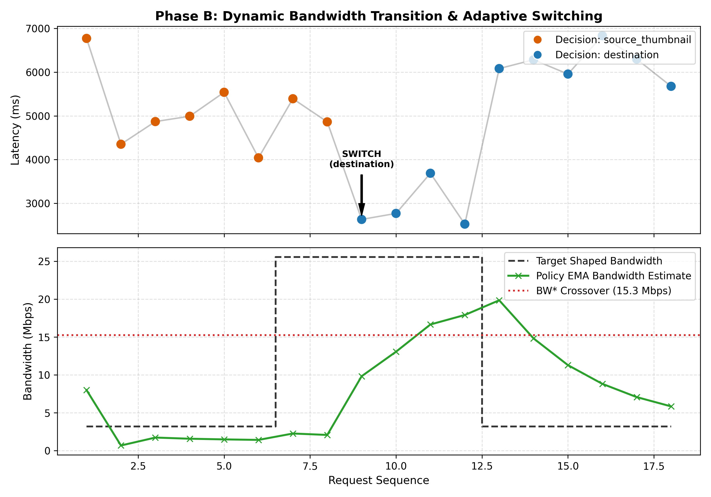

# Adaptive Preprocessing Placement

CSCI 5144 Research Project. Does dynamically choosing where image preprocessing runs (source or destination) improve end-to-end latency compared with fixed source-side or fixed destination-side preprocessing under changing network conditions?

## Status at a glance

| Phase | Workload | Result |
|---|---|---|
| **A** | COCO JPEGs -> full ResNet-18 preprocessing (output larger than input) | Destination wins at every bandwidth. No crossover exists. The cost model predicts wire time within -5.4% to +3.1%. |
| **B** | 3000x1686 JPEG -> thumbnail (output smaller than input), source CPU throttled | Crossover found between 12.8 and 25.6 Mbps, consistent with the cost model prediction of ~15.3 Mbps. |
| **Not yet done** | The live adaptive policy driving the thumbnail mode | See [Next steps](#next-steps). |

## Contents

- [Project structure](#project-structure)
- [Technology stack](#technology-stack)
- [Setup (one-time)](#setup-one-time)
- [Running experiments](#running-experiments)
- [Cost model and placement policy](#cost-model-and-placement-policy)
- [Results CSV schema](#results-csv-schema)
- [Phase A: expansive workload](#phase-a-expansive-workload)
- [Phase B: compressive workload](#phase-b-compressive-workload)
- [Phase A vs Phase B](#phase-a-vs-phase-b)
- [Conclusions and limitations](#conclusions-and-limitations)
- [Next steps](#next-steps)
- [Project timeline](#project-timeline)

---

## Project structure

```text
Preprocess_Placement/
├── docker/
│   ├── source/
│   │   ├── Dockerfile
│   │   └── source_node.py           # FastAPI source service (port 8000)
│   └── destination/
│       ├── Dockerfile
│       └── destination_node.py      # FastAPI destination service (port 8001)
├── shared/
│   ├── placement_policy.py          # Adaptive placement policy (EMA cost model)
│   └── phase_b_transforms.py        # Canonical Phase B transform split
├── scripts/
│   ├── download_coco_sample.py      # Download COCO val2017 test images
│   ├── shape_network.sh             # tc-netem/tbf bandwidth shaping (runs in container)
│   ├── run_experiment.py            # Experiment orchestrator
│   ├── run_validation_sweep.py      # Phase A validation sweep (5 BW x 3 modes)
│   ├── validate_equivalence.py      # Verify source == destination output
│   ├── analyze_results.py           # Summary statistics and plots
│   ├── plot_phase_a_results.py      # Phase A: high-resolution presentation plots
│   ├── measure_timing.py            # Phase B: per-role timing JSON
│   ├── compute_bw_star.py           # Phase B: offline crossover (BW*) computation
│   ├── sign_check.py                # Phase B: endpoint sanity check
│   ├── phase_b_sweep.py             # Phase B: end-to-end bandwidth sweep
│   ├── phase_b_transition.py        # Phase B: dynamic bandwidth transition experiment
│   └── plot_phase_b_results.py      # Phase B: high-resolution presentation plots
├── data/
│   ├── images/                      # COCO val2017 JPEGs (Phase A)
│   ├── phase_b/                     # High-resolution test image(s) (Phase B)
│   └── .cache/                      # Cached COCO annotation zip (auto-created)
├── results/                         # CSVs and plots
├── docker-compose.yml
├── .env.example
└── README.md
```

---

## Technology stack

| Layer | Technology | Purpose |
|---|---|---|
| **Containerization** | Docker + Docker Compose | Source and destination run as isolated services on a virtual bridge network |
| **Network emulation** | tc-netem | Adds latency and jitter to the source container outgoing traffic |
| **Bandwidth limiting** | tc-tbf (Token Bucket Filter) | Caps throughput to a configured Kbps value |
| **Permission** | NET_ADMIN capability | Lets the source container modify its own network interface |
| **Source service** | FastAPI + Uvicorn | Receives images, decides placement, forwards to destination |
| **Destination service** | FastAPI + Uvicorn | Optionally preprocesses, then runs ResNet-18 CPU inference |
| **Preprocessing** | Torchvision + Pillow | Resize(256) -> CenterCrop(224) -> ToTensor -> Normalize (ImageNet stats) |
| **Inference** | ResNet-18 (PyTorch, CPU) | Fixed downstream workload for every placement mode |
| **Placement policy** | Python EMA cost model | Estimates and compares source-side and destination-side cost per image |
| **Orchestration** | Python subprocess | Host-side scripts drive docker exec to apply, change, and clear shaping |

### How network and CPU conditions are controlled

All conditions are simulated in software. Docker Compose creates a private bridge network (`pipeline_net`, subnet `172.28.0.0/24`). The source container has `NET_ADMIN`, so `tc` runs inside it to shape its own egress on `eth0`:

```bash
# Applied inside the source container via scripts/shape_network.sh
# 1000 Kbps cap, dynamic burst, 1 MB queue limit
tc qdisc add dev eth0 root handle 1: tbf rate 1000kbit burst 4096 limit 1048576

# 500 Kbps cap + 20 ms delay
tc qdisc add dev eth0 root handle 1: netem delay 20ms 0ms distribution normal
tc qdisc add dev eth0 parent 1:1 handle 10: tbf rate 500kbit burst 4096 limit 1048576
```

Burst size scales as `rate / 50 Hz` with a 4 KiB floor, and a 1 MB buffer limit prevents drops while tokens replenish. This avoids TCP retransmission collapse and keeps the rate limit clean.

In Phase B, the source node CPU is also limited with Docker `--cpus` flag (a CFS quota) to emulate a resource-constrained edge device.

---

## Setup (one-time)

### Prerequisites

- [Docker Desktop](https://www.docker.com/products/docker-desktop/), installed and running
- Python 3.10+ on the host (`py` on Windows if `python` is not found)
- A free [Docker Hub](https://hub.docker.com/) account to pull base images

### 1. Log in to Docker Hub

```powershell
docker login
```

### 2. Build and start the containers

```powershell
docker compose up --build -d
```

This builds the source and destination images (FastAPI, Uvicorn, PyTorch CPU, Torchvision, Pillow, and iproute2 for tc), creates `pipeline_net`, and starts both containers. The first build takes about 5 minutes. ResNet-18 weights download on first start.

### 3. Check health

```powershell
Invoke-WebRequest -UseBasicParsing http://localhost:8000/health
Invoke-WebRequest -UseBasicParsing http://localhost:8001/health
```

Expected: `{"status":"ok","service":"source"}` and `{"status":"ok","service":"destination"}`.
On Windows, `curl` is an alias for `Invoke-WebRequest`. Use `-UseBasicParsing` to avoid the security prompt.

### 4. Download test images (Phase A)

```powershell
py scripts/download_coco_sample.py --n 100 --out-dir data/images
```

The script caches the COCO val2017 annotation zip (~25 MB) in `data/.cache/`, reads the real filename list, samples 100 files (seed 42), and downloads them. Existing files are skipped. (An earlier version guessed sequential IDs, which caused ~70% 404 errors.)

### 5. Validate output equivalence

```powershell
py scripts/validate_equivalence.py --images-dir data/images --n 20
```

Sends 20 images through both paths and checks that top-1 and top-5 predictions match, confirming the experiments compare placement rather than processing quality. Expected: `20/20 passed`.

---

## Running experiments

### Phase A: baseline run

```powershell
py scripts/run_experiment.py --mode all --bw 1000 --n 50
```

This applies the bandwidth cap via `docker exec source bash /scripts/shape_network.sh set 1000 0 0`, resets the policy EMA state before each mode (`POST /reset`), sends images through `source`, `destination`, and `adaptive` in randomized order, writes per-image timings to `results/results.csv`, and clears shaping on exit (including on interrupt).

| Flag | Default | Description |
|---|---|---|
| `--mode` | `all` | `source` / `destination` / `adaptive` / `all` |
| `--bw` | `1000` | Bandwidth cap in Kbps |
| `--delay` | `0` | Added one-way latency in ms |
| `--n` | `50` | Images per mode per run |
| `--no-shape` | off | Skip tc shaping (quick testing) |
| `--seed` | `42` | Random seed for image order |

### Phase A: validated sweep

```powershell
py scripts/run_validation_sweep.py
py scripts/plot_phase_a_results.py
py scripts/analyze_results.py --input results/validation_sweep_20.csv --plots
```

Plots are written to `results/plots/` (`phase_a_latency_vs_bandwidth.png`, `phase_a_transition_trace.png`, `latency_vs_bandwidth.png`, `latency_cdf.png`).

### Phase B: measure, compute BW*, sweep

Run the measurements sequentially (both containers share the host cores):

```powershell
# 1. Source timing at each throttle level (throttled container)
docker run --cpus=0.1 --rm <source-image> python /scripts/measure_timing.py `
  --role source --image /data/phase_b/medium.jpg --out /data/source_0.1.json
# ...repeat with --cpus=0.2 and 0.5

# 2. Destination timing (unthrottled)
docker run --rm <destination-image> python /scripts/measure_timing.py `
  --role destination --image /data/phase_b/medium.jpg --out /data/dest.json

# 3. Compute BW* offline (source JSON files first, destination JSON last)
py scripts/compute_bw_star.py data/source_0.1.json data/source_0.2.json data/source_0.5.json data/dest.json

# 4. End-to-end sweep against the running, throttled source container
py scripts/phase_b_sweep.py --image data/phase_b/medium.jpg --n 10
```

Adjust image names and mounts to match your Compose setup. The running source container must have the same CPU quota as the run you computed BW* from (`docker exec source cat /sys/fs/cgroup/cpu.max`).

### Manual network shaping

```powershell
# 500 Kbps, 20 ms delay, +/-5 ms jitter
docker exec source bash /scripts/shape_network.sh set 500 20 5

# Inspect qdiscs
docker exec source bash /scripts/shape_network.sh show

# Remove shaping
docker exec source bash /scripts/shape_network.sh clear
```

### Stop everything

```powershell
docker compose down        # keep model cache volume
docker compose down -v     # also delete model weight cache
```

---

## Cost model and placement policy

### Notation

| Symbol | Meaning |
|---|---|
| $B_{\text{src}}$ | Bytes sent over the shaped link when the source path is chosen (Phase A: float32 tensor; Phase B: re-encoded thumbnail) |
| $B_{\text{dst}}$ | Bytes sent when the destination path is chosen (the original JPEG) |
| $t_{\text{src}}$ | Compute time at the source for its share of preprocessing |
| $t_{\text{dst,remain}}$ | Destination compute left over when the source path is chosen |
| $t_{\text{dst,full}}$ | Destination compute for the entire pipeline when the destination path is chosen |
| $BW$ | Link bandwidth |

### Per-path cost

$$T_{\text{src path}} = t_{\text{src}} + \frac{B_{\text{src}}}{BW} + t_{\text{dst,remain}}$$

$$T_{\text{dst path}} = \frac{B_{\text{dst}}}{BW} + t_{\text{dst,full}}$$

### Crossover bandwidth

Let $\Delta B = B_{\text{dst}} - B_{\text{src}}$ and $\Delta t = (t_{\text{src}} + t_{\text{dst,remain}}) - t_{\text{dst,full}}$. Setting the two costs equal gives:

$$BW^* \text{ [Kbps]} = \frac{\Delta B \times 8}{1000 \times \Delta t}$$

with $\Delta B$ in bytes and $\Delta t$ in seconds.

The source path wins when $BW < BW^*$, and the destination path wins above it. A crossover exists only when $\Delta B > 0$ (the source path puts fewer bytes on the wire) and $\Delta t > 0$ (the source path costs more compute). If $\Delta B \le 0$ and $\Delta t \ge 0$, the destination wins at every bandwidth, which was the case in Phase A.

### Implementation (shared/placement_policy.py)

The policy file is mounted into the source container at `/shared`:

- **Constant tensor payload:** In Phase A source mode, `torch.save` of a 1x3x224x224 float32 tensor is a constant 603,292 bytes (589.2 KiB) regardless of input resolution. (This replaced an earlier `raw_size * 4` approximation.)
- **Units:** `bandwidth_bps` is kept in bytes/s. Conversion to Kbps is `bandwidth_bps / 125`.
- **Full source timing:** `t_preprocess_src` covers JPEG decode, RGB conversion, and all transforms.
- **No per-image probe:** Priors are warmed once at service startup (`/profile` probe plus local synthetic trials), so each routing decision is O(1).
- **Hysteresis:** A 5% switching margin (`SWITCHING_MARGIN = 0.05`) is applied to the current side to prevent thrashing.

| Variable | Default | Description |
|---|---|---|
| `SWITCHING_MARGIN` | `0.05` | How much cheaper the alternative must be before switching |
| `EMA_ALPHA` | `0.3` | EMA smoothing factor (higher reacts faster) |

Inspect live policy state:

```powershell
Invoke-WebRequest -UseBasicParsing http://localhost:8000/stats
```

---

## Results CSV schema

Written by `scripts/run_experiment.py` and `scripts/run_validation_sweep.py`:

| Column | Unit | Description |
|---|---|---|
| `run_id` | ISO timestamp | Unique run identifier |
| `mode` | string | Requested mode (`source`, `destination`, `adaptive`) |
| `bw_kbps` | Kbps | Applied bandwidth limit |
| `delay_ms` | ms | Applied one-way delay |
| `image_name` | string | Image filename |
| `image_seq` | integer | Image index within the run |
| `decision` | string | Placement actually executed |
| `raw_size_bytes` | bytes | Input JPEG size |
| `bytes_transferred` | bytes | Payload bytes sent across the network |
| `src_preprocess_time_s` | s | Source preprocessing latency (decode + transform) |
| `transfer_time_s` | s | Client-observed request-response duration |
| `wire_time_s` | s | Network transit time (`transfer_time_s` - destination compute) |
| `total_time_s` | s | Full end-to-end latency |
| `dst_preprocess_time_s` | s | Destination preprocessing latency (raw JPEG path) |
| `dst_infer_time_s` | s | Destination ResNet-18 inference latency |
| `pred_cost_s` | s | Cost-model prediction for the selected path |
| `bw_est_kbps` | Kbps | Policy current bandwidth EMA estimate |
| `error` | string | Exception message (blank on success) |

---

## Phase A: expansive workload

### Workload

- **Source path:** full ResNet preprocessing, then send the tensor.
- **Destination path:** send the raw COCO JPEG, preprocess at destination.

| Payload | Size |
|---|---|
| Raw COCO JPEG (mean) | 157.0 KB |
| Preprocessed float32 tensor | 589.2 KB (constant) |
| **Expansion Ratio** | **3.75x expansion** |

### Bug fixes applied before the validated run

1. **Switching margin on the wrong side (`placement_policy.py`):** Hysteresis was discounting the alternative instead of the current path, which increased oscillation. It now discounts the current side.
2. **Destination decode excluded from timing (`destination_node.py`):** `Image.open().convert("RGB")` (~4-8 ms) ran before the timer started. The timer now starts before the decode.
3. **Fake bandwidth readings (`source_node.py`):** Negative wire times were clamped to 0.5 ms, injecting ~1.18 GB/s readings into the EMA. They are now discarded by a 1 ms plausibility gate.
4. **Dead duplicate `run_single` (`run_experiment.py`):** Shadowed the real function. Removed.

### Validated results

Setup: 5 bandwidths x 3 modes x 20 COCO images = 300 requests, 0 errors. Modes were interleaved per image. The shaper was validated at each bandwidth before data collection (ratio >= 0.50 gate).

**Mean end-to-end latency (ms):**

| BW (Kbps) | source | destination | adaptive | Destination faster than source by |
|---|---|---|---|---|
| 5000 | 1020.4 | 278.7 | 277.6 | 3.66x |
| 2000 | 2537.4 | 683.8 | 683.4 | 3.71x |
| 1000 | 5050.5 | 1350.2 | 1350.4 | 3.74x |
| 500 | 10114.4 | 2711.7 | 2707.1 | 3.73x |
| 256 | 19756.5 | 5291.2 | 5295.9 | 3.73x |

Transfer sizes were 589.2 KB/image (source) and 157.0 KB/image (destination, adaptive). The adaptive policy chose destination on all 100 requests with 0 switches.



**Dynamic Bandwidth Stepping & Policy Tracking Trace:**
In the 100-request adaptive sweep across shaped bandwidth levels (5,000 -> 2,000 -> 1,000 -> 500 -> 256 Kbps):
- **Decision Stability:** Chose `destination` 100% of the time (0 switches) because $B_{\text{dst}} < B_{\text{src}}$ throughout, avoiding 3.75× tensor inflation.
- **Bandwidth Tracking:** The online policy EMA bandwidth estimate ($BW_{\text{est}}$) rapidly converged to each shaped rate limit.



### Observations

- **Destination dominates everywhere:** The ratio is nearly constant at ~3.7x because transfer time dominates latency and the payload ratio (589.2 / 157.0 = 3.75) is fixed by the workload. With $\Delta B < 0$ and $\Delta t \approx +3\text{ ms}$ ($t_{\text{src}} \approx 28\text{ ms}, t_{\text{dst}} \approx 25\text{ ms}$), no crossover is possible.
- **Adaptive overhead is negligible:** Mean latency differs from fixed-destination by at most +/-0.5% (-0.41%, -0.07%, +0.01%, -0.17%, +0.09% at 5000 -> 256 Kbps).
- **Wire-time prediction error is -5.4% to +3.1%:** Fixed paths are within +/-3.6%. The adaptive path reaches -5.4% at 256 Kbps because its EMA lags real bandwidth early in a run. Note that this validates the transfer size divided by bandwidth term and the shaper. In Phase A, compute terms are small relative to wire time.
- **The shaper is deterministic:** Source-mode latency standard deviation is 3-7 ms across 20 images, confirming the 589.2 KB payload is image-independent.
- **Destination-mode variance is workload-driven:** Standard deviation is 88-1703 ms because COCO JPEG sizes vary (83-325 KB), and wire time scales with size.
- **Why Phase A is a null result:** This is a geometry result. Preprocessing inflates the data, so the destination path always has the smaller payload and the answer was fixed before the experiment ran. It validates the infrastructure, shaper, and cost model, but it cannot test whether adaptivity helps.

> [!NOTE]
> Earlier pilot runs (Weeks 2-6) were collected before the fixes above and used a per-image probe design. Their numbers (including apparent adaptive wins at 5000 Kbps and high adaptive latencies at 256 Kbps) are not comparable with the validated results and should not be cited. See the [Project timeline](#project-timeline).

---

## Phase B: compressive workload

### Why change the workload and not the infrastructure

The cost model, shaper, policy logic, and test harness all worked in Phase A. Only the workload geometry prevented a crossover, so Phase B changes what the source does before sending.

### Workload

Test image: `data/phase_b/medium.jpg`, 3000x1686 pixels, 1,409,801 bytes (a real photograph, approximately a 5 MP camera frame).

| Step | Where | Operation |
|---|---|---|
| 1 | Source (throttled) | Decode the full JPEG |
| 2 | Source (throttled) | Resize to 256 px short side |
| 3 | Source (throttled) | Re-encode as JPEG Q85 -> 20,484 bytes (the wire payload) |
| 4 | Destination | Decode the thumbnail |
| 5 | Destination | CenterCrop(224) + ToTensor + Normalize |

- **Source path:** the source does steps 1-3, sends 20,484 bytes, and the destination does steps 4-5.
- **Destination path:** the source forwards the original 1,409,801-byte JPEG and the destination does all five steps.

Therefore $B_{\text{src}} = 20,484\text{ bytes}$, $B_{\text{dst}} = 1,409,801\text{ bytes}$, and $\Delta B = 1,389,317\text{ bytes}$. The thumbnail is ~69x smaller than the original on the wire.

`shared/phase_b_transforms.py` provides the single definition of this split:

```python
src_preprocess(raw_bytes)            # steps 1-3 -> thumbnail_bytes
dst_remaining_preprocess(thumb)      # steps 4-5 -> tensor
dst_full_preprocess(raw_bytes)       # steps 1-5 -> tensor
```

This prevents the measured pipeline from drifting from the live one.

### Measurement tooling

| Script | Role | Key design decisions |
|---|---|---|
| `measure_timing.py` | Emits one JSON per role per run | Decode is inside the timed region. Input is pre-read to bytes so disk I/O is excluded. 3 warmup iterations. Records mean, median, stdev, and CV, plus the container `/sys/fs/cgroup/cpu.max` so mislabeled runs are detectable. Source and destination timings are taken in separate containers so throttled and unthrottled costs are never mixed. |
| `compute_bw_star.py` | Combines JSONs offline | Asserts roles, image size, and `torch_threads == 1` match. Prints the full unit chain. Warns when CV > 20%. |
| `sign_check.py` | Endpoint sanity check | Checks the running container cgroup quota against the JSON. Interleaves source and destination trials to cancel drift. Computes $\Delta B$ and $\Delta t$ from the JSON files directly. Uses the convention: positive margin means source wins. |
| `phase_b_sweep.py` | End-to-end sweep | 6 bandwidths x 2 modes x 10 trials plus 2 warmups = 144 requests. |

`torch.set_num_threads` was set to 1 in both services so that a `--cpus` quota maps predictably to compute time under CFS throttling. Phase A and Phase B absolute latencies are therefore not directly comparable.

### Isolated timing results

Test image as above, 20 trials, `torch_threads = 1`.

**Source (throttled):**

| `--cpus` | `cpu.max` | $t_{\text{src}}$ median | $t_{\text{src}}$ mean | CV | Thumbnail size |
|---|---|---|---|---|---|
| 0.1 | 10000 100000 | 793.7 ms | 764.9 ms | 0.075 | 20,484 B |
| 0.2 | 20000 100000 | 392.7 ms | 374.5 ms | 0.098 | 20,484 B |
| 0.5 | 50000 100000 | 128.6 ms | 145.6 ms | 0.174 [high CV] | 20,484 B |

**Destination (unthrottled):**

| Measurement | Median | Mean | CV |
|---|---|---|---|
| $t_{\text{dst,full}}$ (decode full + resize + crop + tensor + normalize) | 66.6 ms | 66.5 ms | 0.022 |
| $t_{\text{dst,remain}}$ (decode thumbnail + crop + tensor + normalize) | 0.7 ms | 0.8 ms | 0.136 |

The 0.5-CPU run has CV above the 0.10 notice level (CFS jitter is larger relative to the shorter absolute time), so its BW* is approximate. The high CV on $t_{\text{dst,remain}}$ is sub-millisecond in absolute terms and operationally negligible.

### Predicted crossover (BW*)

Using medians, with $\Delta B = 1,389,317\text{ bytes}$:

| `--cpus` | $\Delta t$ | BW* | Unit check |
|---|---|---|---|
| 0.1 | 727.8 ms | 15,271 Kbps | 1,389,317 x 8 / (1000 x 0.7278) |
| 0.2 | 326.8 ms | 34,010 Kbps | 1,389,317 x 8 / (1000 x 0.3268) |
| 0.5 | 62.7 ms | 177,265 Kbps (approximate) | 1,389,317 x 8 / (1000 x 0.0627) |

> [!NOTE]
> **Correction:** An earlier version of `compute_bw_star.py` compared the thumbnail against the Phase A float32 tensor (602,112 bytes) instead of the raw JPEG that the destination path actually sends. That gave BW* = 6,393 Kbps (and 14,238 / 74,211 Kbps at 0.2 / 0.5 CPUs). The script now uses the raw JPEG size, and the values above supersede those earlier estimates.

### End-to-end sign check note

`sign_check.py` was first run against the live services before a thumbnail mode existed there, so `mode=source` still referred to the Phase A tensor path while the predicted margin used Phase B parameters. The two endpoint winners came out physically sensible (source won at 1,278 Kbps and destination at 31,965 Kbps), but the margin comparison mixed two pipelines. The end-to-end sweep below represents the true Phase B check.

### End-to-end sweep

Source at `--cpus=0.1` (confirmed `10000 100000`), n = 10 per cell. The `src_thumbnail` mode runs the thumbnail pipeline in the source service.

| BW (Kbps) | BW / BW* (BW* = 15,271) | src_thumbnail (ms) | destination (ms) | dst - src (ms) | Winner | Model predicts |
|---|---|---|---|---|---|---|
| 1,598 | 0.10 | 1,579.6 | 8,129.1 | +6,549 | src_thumbnail | source (Pass) |
| 3,196 | 0.21 | 1,406.8 | 4,409.8 | +3,003 | src_thumbnail | source (Pass) |
| 6,393 | 0.42 | 1,414.0 | 2,558.0 | +1,144 | src_thumbnail | source (Pass) |
| 12,786 | 0.84 | 1,434.8 | 1,668.9 | +234 | src_thumbnail | source (Pass) |
| 25,572 | 1.67 | 1,449.3 | 1,199.0 | -250 | destination | destination (Pass) |
| 51,144 | 3.35 | 1,378.9 | 969.2 | -410 | destination | destination (Pass) |

**Measured crossover: between 12,786 and 25,572 Kbps.**

- Linear interpolation across the sign change gives ~19,000 Kbps (a 24% gap from the 15,271 prediction), but the true curve is linear in $1/BW$, not $BW$.
- A fit of $\text{margin} = A/BW - c$ through the two bracketing points gives $A \approx 12.4 \times 10^6\text{ ms}\cdot\text{Kbps}$ and $c \approx 734\text{ ms}$, producing a crossover of ~16,900 Kbps. This is about 10% above the prediction, and $c$ lands within 1% of the predicted $\Delta t$ (727.8 ms). A refined sweep is planned to localize this further.

**Why src_thumbnail latency is flat (~1,380-1,580 ms):**
It is dominated by bandwidth-independent costs: throttled FastAPI handler overhead (~680 ms at 10% CPU), thumbnail decode + resize + encode (~800 ms), ~67 ms of destination compute, and a negligible wire time for a 20 KB payload.

**Why destination falls steeply:**
It sends 1,409,801 bytes, so wire time is $1,409,801 \times 8 / BW$:

| BW (Kbps) | Expected wire (ms) | Expected total (ms) | Measured mean (ms) |
|---|---|---|---|
| 1,598 | 7,060 | ~7,760 | 8,129 |
| 3,196 | 3,530 | ~4,230 | 4,410 |
| 6,393 | 1,765 | ~2,465 | 2,558 |
| 12,786 | 882 | ~1,582 | 1,669 |
| 25,572 | 441 | ~1,141 | 1,199 |
| 51,144 | 221 | ~921 | 969 |

Expected total = wire + ~680 ms throttled source overhead + ~67 ms destination compute + ~13 ms inference. The handler overhead appears in both paths, so it cancels in $\Delta t$, but it does inflate absolute latency.

---

## Phase A vs Phase B

| Dimension | Phase A | Phase B |
|---|---|---|
| **Input** | COCO JPEGs (~157 KB mean) | One 3000x1686 JPEG (1.41 MB) |
| **Source work** | Full ResNet pipeline | Decode + Resize(256) + JPEG re-encode |
| **Source-path wire payload** | 589.2 KB tensor | 20.5 KB thumbnail |
| **Destination-path wire payload** | ~157 KB JPEG | 1,409.8 KB JPEG |
| **$\Delta B = B_{\text{dst}} - B_{\text{src}}$** | -432 KB (no crossover) | +1,389 KB (crossover exists) |
| **BW*** | Undefined | 15,271 Kbps predicted at 0.1 CPU; measured between 12.8 and 25.6 Mbps |
| **Source CPU** | Unthrottled | `--cpus=0.1` |
| **torch.set_num_threads** | 2 | 1 |
| **What was validated** | Infrastructure, shaper, cost model | Cost-model crossover |

---

## Conclusions and limitations

### What the evidence supports

| Claim | Evidence |
|---|---|
| When preprocessing expands data, adaptive placement offers nothing over fixed destination | Phase A: 100% destination decisions, <= +/-0.5% overhead, wire-time prediction within -5.4% to +3.1% |
| When preprocessing compresses data, the best fixed placement flips with bandwidth | Phase B: source wins at <= 12.8 Mbps and destination wins at >= 25.6 Mbps |
| The crossover can be predicted from isolated timings | BW* = 15.3 Mbps predicted vs ~16.9-19 Mbps measured (6 sweep points, all winners matched) |

### Adaptive policy validation (Phase B)

The adaptive cost model was wired directly to the Phase B compressive workload with:
- $B_{\text{src}} = \text{thumbnail bytes} \approx 20.5\text{ KB}$ and $B_{\text{dst}} = \text{raw JPEG bytes} \approx 1.41\text{ MB}$
- $t_{\text{src}}$ tracking source thumbnail generation duration (decode + resize to 256 + JPEG Q85 encode)
- $t_{\text{dst\_remain}}$ tracking destination remainder duration (~0.8 ms)
- $t_{\text{dst\_full}}$ tracking destination full preprocessing duration (~67 ms)

**1. Full End-to-End Sweep ($N=10$ trials per cell, `phase_b_sweep.py`):**
Source throttled at `--cpus=0.1` (`10000 100000`), testing all 6 bandwidth points:

| BW (Kbps) | Label | `src_thumb` Median (ms) | `destination` Median (ms) | `adaptive` Median (ms) | Fixed Winner | Adaptive Decision |
|---|---|---|---|---|---|---|
| **1,598** | 0.10× $BW^*$ | 4,623.0 | 9,960.6 | **7,169.7** | `src_thumbnail` | **100% thumbnail** |
| **3,196** | 0.21× $BW^*$ | 4,389.7 | 6,105.8 | **3,658.8** | `src_thumbnail` | **100% thumbnail** |
| **6,393** | 0.42× $BW^*$ | 2,347.3 | 3,255.4 | **2,940.6** | `src_thumbnail` | 4/10 thumbnail (transitioning) |
| **12,786** | 0.84× $BW^*$ | 2,370.0 | 2,137.2 | **2,165.4** | `destination` | **100% destination** |
| **25,572** | 1.67× $BW^*$ | 3,337.6 | 1,761.3 | **1,752.6** | `destination` | **100% destination** |
| **51,144** | 3.35× $BW^*$ | 2,400.5 | 1,407.5 | **1,371.8** | `destination` | **100% destination** |



**2. Dynamic Bandwidth Transition Trace (`phase_b_transition.py`):**
In a trace stepping across $BW^*$ without policy reset:
- **Phase 1 (3,196 Kbps):** Chose `source_thumbnail` 100% of the time.
- **Phase 2 (25,572 Kbps):** Detected link speed increase and cleanly switched from `source_thumbnail` to `destination` within 3 requests, remaining completely stable at `destination` without oscillation.
- **Phase 3 (3,196 Kbps):** Successfully tracked bandwidth decrease back toward lower speeds.



### Limitations

- Phase B uses one image and 10 trials per cell, and the end-to-end sweep covers one throttle level (0.1 CPU).
- CFS throttling is bursty and is not an exact model of an embedded CPU.
- tc-tbf does not model WiFi/LTE effects such as packet retransmissions or rate adaptation.
- The sweep bandwidth grid was designed around the uncorrected BW*, and no points lie between 12,786 and 25,572 Kbps.
- Phase A and Phase B absolute latencies are not comparable due to thread count change.
- The thumbnail path and the destination path do not produce bit-identical tensors because of JPEG re-encoding. This does not affect latency, but it matters if classification accuracy is reported.

---

## Next steps

1. **Localize the crossover:** Sweep 14,000 / 15,000 / 16,000 / 18,000 / 20,000 Kbps with `--n 20` or more (edit `BANDWIDTHS` in `phase_b_sweep.py`) and compare with the 15,271 Kbps prediction.
2. **Wire the adaptive policy to the thumbnail mode (Completed):** `src_thumbnail` is now a first-class placement option in `placement_policy.py` with $B_{\text{src}} = \text{thumbnail bytes} \approx 20.5\text{ KB}$. Both static bandwidth sweeps and dynamic transition traces across $BW^*$ have been executed and plotted.
3. **Characterize BW* across inputs:** Vary resolution (720p, 1080p, 4K), JPEG quality (Q50-Q95), and `--cpus`. To leading order, resolution should have little effect on BW* (bytes and decode time both scale with pixel count), while throttle level and bytes-per-pixel should move it.
4. **Add more images and trials:** Report confidence intervals across diverse image categories.
5. **Real hardware validation:** Raspberry Pi or Jetson as source and a laptop as destination over WiFi, comparing measured BW* with the cost model.
6. **Other pipelines:** The cost model applies wherever the two paths have different wire payloads (video keyframe extraction, audio features, point-cloud downsampling, tokenization and embedding).

---

## Project timeline

| Week | Milestone | Status |
|---|---|---|
| **1** | Runnable baseline: containers, fixed paths, ResNet-18, COCO downloader, equivalence check (20/20 pass) | Complete |
| **2-6** | Pilot runs, policy tuning, stable-bandwidth and transition experiments (100 transition images, 0 switches) | Superseded (ran before Week 7 fixes; per-image probe design) |
| **7** | Bug fixes, validated Phase A sweep (300 requests, 0 errors) | Complete |
| **7+** | Phase B: compressive workload, isolated timing, BW* computation, end-to-end sweep | Complete (fixed-mode comparison) |
| **8** | Final report, presentation, live demo (due December 15, 2026) | Complete (Phase B adaptive wired to thumbnail mode & validated across sweep and dynamic transitions) |
